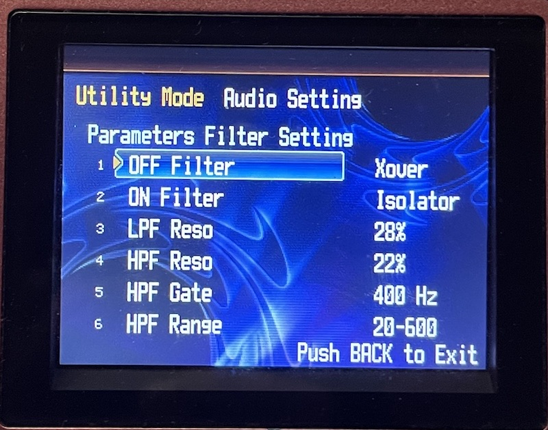

# Filter Control

An optional build of the DN-X1700 firmware: **the USB fix plus settings for the Parameters filter** in the Utility menu.
You choose it in step 3 of the [web tool](https://whatmeansgithub.github.io/DN-X1700/) (or with `tools/x1700_patcher.py --filter`).
The USB-only build stays the default and is the tested one.

> Same warning as for everything in this repository: flashing can permanently damage the mixer, your settings are reset by the
> update, and nobody here accepts responsibility. See the [README](../README.md#read-this-first-disclaimer-and-risks).
> Filter Control has been tested by **one owner on one unit**.

## Why

Denon's Parameters filter (the PARAMETER knob with the filter assigned) has one fixed resonance, about 0.46, on both sides.
On the high-pass side the resonance starts at about 400 Hz, which boosts the low end, and the high-pass sweep starts at 60 Hz
and is at about 1.1 kHz halfway along the knob. Filter Control makes these things adjustable. Its defaults are gentler than
Denon's: lower resonance (less peaking at the cutoff, less bass boost on the high-pass) and a high-pass sweep that starts at
20 Hz and spends more of the knob in the bass and low mids.

## The new settings

**Utility → Parameters Filter Setting** has six rows instead of two. Rows 1 and 2 are Denon's (the filter type for Parameter
OFF and ON: Isolator, Crossover, Through). Rows 3 to 6 are new. Select a row, press ENTER, turn the encoder, press ENTER to
confirm (BACK cancels), like any other Utility setting.

| Row | Choices | Default | What it does |
|---|---|---|---|
| **LPF Reso** | 0 to 100 % in 2 % steps | 28 % | Resonance of the **low-pass** side (knob left of centre). 0 % is a plain filter; higher values add a peak at the cutoff. Denon's stock: 52 %. |
| **HPF Reso** | 0 to 100 % in 2 % steps | 22 % | Resonance of the **high-pass** side (knob right of centre). Separate from the LPF, so you can keep one side clean. Denon's stock: 52 %. |
| **HPF Gate** | Off, 100 to 1000 Hz | 400 Hz | Where the high-pass resonance starts. Below the gate the high-pass has **no** resonance (no bass boost); above it the resonance fades in over the next ten knob steps. Off = resonance from the very start of the sweep. Denon's stock: about 400 Hz. |
| **HPF Range** | Stock, 20-150, 20-200 ... 20-600 ... 20-2500 | 20-600 | How fast the **high-pass opens up** (explained below). The cutoff always runs from 20 Hz to 20 kHz across the knob; this sets the cutoff at the halfway point. Lower = more of the knob in the bass, higher = the mids sooner. Stock = Denon's original curve: 60 Hz at the start, about 1.1 kHz at the halfway point, 20 kHz at the end. |

The choices for HPF Range are Stock and 20 Hz up to 150, 200, 250, 300, 350, 400, 450, 500, 550, 600, 700, 800, 900, 1000, 1200,
1400, 1600, 1800, 2000 and 2500 Hz at the halfway point. The HPF Gate list is 100, 105, 110, 115, 120, 125, 130, 140 ... 1000 Hz in
steps of about 5 % (the gate can only sit on one of the knob's own steps, which are about that far apart).

**HPF Range in one picture.** Look only at the right half of the knob, the high-pass side. Its cutoff always starts at 20 Hz
(knob just right of the centre) and ends at 20 kHz (knob all the way right). HPF Range decides where the cutoff is when the knob
is **halfway** between those two points. With the default 20-600, the first half of that travel covers 20 Hz to 600 Hz and the
second half covers 600 Hz to 20 kHz. With 20-200 the first half only reaches 200 Hz, so you get very fine control of the bass
and the mids arrive late; with 20-2000 the sweep gets into the mids quickly. Stock is Denon's own curve, which starts at 60 Hz and
is at about 1.1 kHz halfway.

**Resonance scale.** The same on both sides: 100 % is a resonance value of 0.89, just below self-oscillation. 52 % is
Denon's stock amount (0.46). **Turn the volume down when you try values
above about 70 %**: the peak at the cutoff gets loud, especially with the low-pass at a low cutoff.

**The gate follows the range.** The gate is a frequency: if you change HPF Range, the gate stays at (about) the same number of
Hz. With Range on Stock, 400 Hz lands on Denon's own stock gate step.

**When it applies.** The values are used when you leave the Utility menu, and the sound changes the next time you move the
PARAMETER knob. No restart needed.

**Presets and export.** The four values are stored in settings bytes that Denon's firmware does not use, so they are saved with the
other settings and included in **Preset Export / Import**. A stock mixer imports such a file without complaint and ignores those
bytes. A preset made on a stock mixer (or on the USB-only build) has zeros there, which means "default".

## Defaults compared with Denon's stock filter

| | Stock | Filter Control default |
|---|---|---|
| Low-pass resonance | 0.46 (52 %) | 0.25 (28 %) |
| High-pass resonance | 0.46 (52 %), starts at 403 Hz | 0.20 (22 %), starts at 400 Hz |
| High-pass sweep | 60 Hz at the first step, about 1.1 kHz halfway along the knob | 20 Hz at the first step, 600 Hz halfway along the knob |

To get back to Denon's behaviour, set LPF Reso to 52 %, HPF Reso to 52 %, HPF Range to Stock and HPF Gate to 400 Hz.

## How it works (short)

The filter itself runs on the mixer's DSP, which computes its tables once at start-up from fixed data. The new firmware does
**not** change the DSP's code or data. Instead:

1. The patch adds one small program (about 42 KB, mostly lookup tables) to unused flash after the end of the application, and
   changes nine pointers in the main program: four in the filter-message routine and five in the Utility menu (row count, row
   label, drawing, encoder, ENTER).
2. At start-up, in **normal mode only**, a hook waits until the DSP has finished its own initialisation, copies the program to
   RAM (the DSP loader's staging buffer, which is idle afterwards) and switches the pointers over. In Version UP Mode and the
   service modes nothing is installed.
3. From then on, before every Parameters-filter update the program looks at the four settings. If one has changed it builds
   the resonance/gate table and the high-pass cutoff coefficients and writes them into the DSP with Denon's own write routine.
   It never runs code from flash after start-up (flash can be busy erasing).
4. The menu rows reuse Denon's own value-editor screen, so they look and behave like the other Utility settings. Storing and
   saving is Denon's code.

**Safety check.** Before the HPF Range is written, the program reads 18 cutoff values from the DSP and compares them with the
values it computed itself for Denon's stock curve (within a tiny tolerance). If they do not match, the HPF Range row has no
effect for that session and nothing is written to those tables; resonance and gate still work.

The patch is data, like the others: `patches/filter/101-filter-menu.yaml`, generated and emulator-checked by
`tools/gen_filter_menu.py`. It contains only new code and tables, no Denon code. Build it yourself with
`python3 tools/build.py --extra-dir patches/filter`.

## Tested, and not tested

- One owner, one DN-X1700 on firmware 2.000, flashed from a USB stick. All four new rows were confirmed to work and the filter
  sounds as intended with the defaults.
- The generated code is run against models of Denon's routines in an SH-2A emulator on every build (boot in every system
  mode, settings at their limits, the whole menu walk, the safety check passing and failing).
- Changing the sample rate with non-default values was tried: the settings kept working.
- **Not verified:** use together with other firmware changes; other hardware revisions.
- If you hear something that looks like a defect, please report it.

## Going back

Flash the USB-only build (web tool, "USB fix only") or Denon's original `X1700FW.BIN` through **Version UP Mode**, exactly as
for any update. Your Utility settings are reset by every update.

## If something looks wrong

| You see | Meaning |
|---|---|
| Only the two stock rows in Parameters Filter Setting and the stock filter sound | The start-up hook did not install (nothing else changed). Safe. |
| Six rows, but HPF Range has no effect and the high-pass behaves like Denon's | The safety check switched HPF Range off. Resonance and gate still work. Please report it. |
| Hang, noise or no audio at start-up | Switch off, flash the USB-only build or Denon's original via Version UP Mode. |
